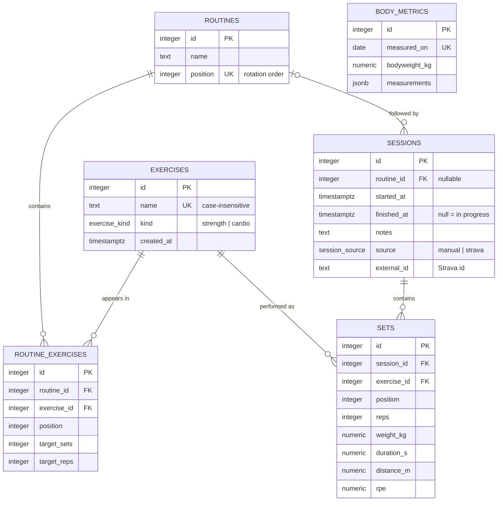

# Data model

This document follows the order the database was designed in: **relational model → ER diagram →
SQL**. The Drizzle schema in `src/db/schema.ts` is the source of truth. This page explains it.

**Built so far:** `exercises`. The other tables are planned and arrive in the slice that needs them.
User accounts come from Better Auth in slice 2, which creates its own tables.

## 1. Relational model

Notation: **PK** = primary key, **FK** = foreign key, **UQ** = unique. Every `id` is an
`integer` generated by Postgres (`GENERATED ALWAYS AS IDENTITY`).

**exercises** ✅ built
| Column | Type | Rules |
|---|---|---|
| id | integer | PK |
| name | text | not null, UQ on `lower(name)`, so "Bench Press" and "bench press" can't both exist |
| kind | exercise_kind | not null, `strength` or `cardio` |
| created_at | timestamptz | not null, default `now()` |

**routines** (Milestone 2): one day in the rotation, like "Push" or "Pull"
| Column | Type | Rules |
|---|---|---|
| id | integer | PK |
| name | text | not null |
| position | integer | not null, UQ: the order in the rotation (A → B → C → A …) |

**routine_exercises** (Milestone 2): which exercises a routine contains, in order
| Column | Type | Rules |
|---|---|---|
| id | integer | PK |
| routine_id | integer | FK → routines, delete with the routine |
| exercise_id | integer | FK → exercises |
| position | integer | not null, UQ together with `routine_id` |
| target_sets | integer | nullable |
| target_reps | integer | nullable |

**sessions** (Milestone 1): one workout
| Column | Type | Rules |
|---|---|---|
| id | integer | PK |
| routine_id | integer | FK → routines, nullable (a free-form workout has no routine) |
| started_at | timestamptz | not null |
| finished_at | timestamptz | nullable: `null` means the workout is still in progress |
| notes | text | nullable |
| source | session_source | not null, `manual` or `strava`, default `manual` |
| external_id | text | nullable: the Strava activity id. UQ together with `source`, so re-importing never duplicates |

**sets** (Milestone 1): one set of an exercise within a session
| Column | Type | Rules |
|---|---|---|
| id | integer | PK |
| session_id | integer | FK → sessions, delete with the session |
| exercise_id | integer | FK → exercises |
| position | integer | not null: the order within the session |
| reps | integer | strength |
| weight_kg | numeric | strength, **kilograms** at full precision |
| duration_s | numeric | cardio, **seconds** |
| distance_m | numeric | cardio, **meters** |
| rpe | numeric | nullable, 1–10 |

**body_metrics** (Milestone 3)
| Column | Type | Rules |
|---|---|---|
| id | integer | PK |
| measured_on | date | not null, UQ: one entry per day |
| bodyweight_kg | numeric | nullable |
| measurements | jsonb | nullable, e.g. `{"waist_m": 0.81}` |

## 2. ER diagram

How to read the lines: `||` means exactly one, `o{` means zero or more, and `|o` means zero or
one. For example, `ROUTINES |o--o{ SESSIONS` says each session belongs to **zero or one** routine,
and each routine has **zero or more** sessions.

## 3. SQL

Drizzle generates the SQL from `src/db/schema.ts`. The files in `drizzle/` are committed, and every
environment runs them in order:

| File | What it does | How it was made |
|---|---|---|
| `drizzle/0000_*.sql` | Creates the `exercise_kind` enum, the `exercises` table and the `lower(name)` unique index | `npm run db:generate` |
| `drizzle/0001_seed_exercises.sql` | Inserts the starter exercises (12 strength, 6 cardio) | `npx drizzle-kit generate --custom`, then written by hand |

To change the database: edit `src/db/schema.ts`, run `npm run db:generate`, read the new SQL file,
then run `npm run db:migrate`. Never change the database by hand.

## Rules the schema doesn't show

- **Units:** stored as kilograms, meters and seconds at full precision, and displayed as lb, miles
  and min/mi. Conversion and display rounding live in `src/lib/units.ts`. See `SPEC.md`.
- **Next workout:** the routine whose `position` comes after the routine of the last *finished*
  session, wrapping back to the first. It's calculated on the fly, not stored.
- **PRs:** calculated by queries over `sets` (heaviest weight per rep count, estimated 1RM with the
  Epley formula, fastest pace per distance). Not stored.
