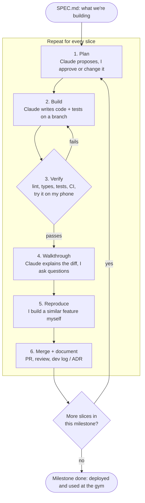

# How this project is built: the AI-assisted milestone loop

Each feature is built in one small slice at a time. Claude writes most of the code. I act as the
architect, reviewer and quality gate, and I build one similar piece myself so I learn it.



## The steps

| # | Step | Who | Output | What I learn |
|---|---|---|---|---|
| 1 | **Plan** | Claude proposes, I approve or change it | A short plan: files, data changes, tests | Breaking a feature into steps |
| 2 | **Build** | Claude | Code + tests on a feature branch | What a pro-level slice looks like |
| 3 | **Verify** | Automated checks + me | Passing checks; the feature works on my phone | How to catch AI mistakes |
| 4 | **Walkthrough** | Claude explains, I ask questions | I can explain every file in the diff | How the pieces connect |
| 5 | **Reproduce** | Me, with Claude helping | A similar feature that I wrote | Actually doing it myself |
| 6 | **Merge + document** | Me | A merged PR, plus a dev log entry or ADR | The professional workflow |

## Step by step

### 1. Plan
- Start from the milestone in `SPEC.md`. Pick **one slice** that works end to end, from screen to database.
- Ask Claude for a plan before any code is written (plan mode: `Shift+Tab` in Claude Code).
- Push back on the plan. Fixing a plan is much cheaper than fixing code.

### 2. Build
```bash
git switch -c feat/<slice-name>      # one branch per slice
```
- Claude writes the code **and the tests**, following the rules in `CLAUDE.md`.
- Keep slices small. If a diff is too big to review in one sitting, the slice is too big.

### 3. Verify
```bash
npm run lint                         # code style and common mistakes
npx tsc --noEmit                     # type check
npm test                             # added in the guardrails step
docker compose up -d --build         # does the real container still work?
```
- CI (GitHub Actions) runs the same checks on every push.
- Open the app on my phone and use the feature the way I would at the gym.
- If anything fails, go back to **Build**. Never merge something red.

### 4. Walkthrough
- Go through the diff file by file: `git diff main...HEAD`
- For each file, ask: *What does this do? Why here? What happens if it breaks?*
- Done when I could explain the change in an interview.

### 5. Reproduce
- Build a **similar** feature myself, using the walkthrough as a reference. Claude acts as a pair
  programmer, not the author.
- Example: Claude builds "log a strength set", and I build "log a cardio entry".

### 6. Merge + document
```bash
gh pr create --fill                  # open a pull request
```
- Run `/code-review` for a second opinion, fix what matters, then merge.
- Add a short entry to the dev log (what I built, what broke, what I learned).
- If I made a real decision (a library, a tradeoff), write an ADR in `docs/decisions/`.

## Definition of done (every slice)
- [ ] Lint, type check and tests pass locally and in CI
- [ ] Works on my phone
- [ ] I can explain every file in the diff
- [ ] I built the "reproduce" feature myself
- [ ] PR merged into `main`
- [ ] Dev log updated (and an ADR, if a decision was made)

## Guardrails (set up once, before Milestone 1)
These make it safe to let AI write most of the code:
- **`CLAUDE.md`**: project rules that Claude reads every session (stack, conventions, "every feature gets a test").
- **Tests**: a test framework so behavior is checked automatically.
- **CI**: GitHub Actions runs lint, types and tests on every push and PR.
- **Branch + PR flow**: nothing goes into `main` without passing checks and a review.

## Example: Milestone 1 (log a workout)
| Slice | Claude builds | I reproduce |
|---|---|---|
| 1 | Database setup + `exercises` table + an exercise list page | An "add exercise" form |
| 2 | Login with Better Auth | Add a logout button + a protected route |
| 3 | Start a session + log a strength set | Log a cardio entry |
| 4 | History list of past sessions | A session detail page |
